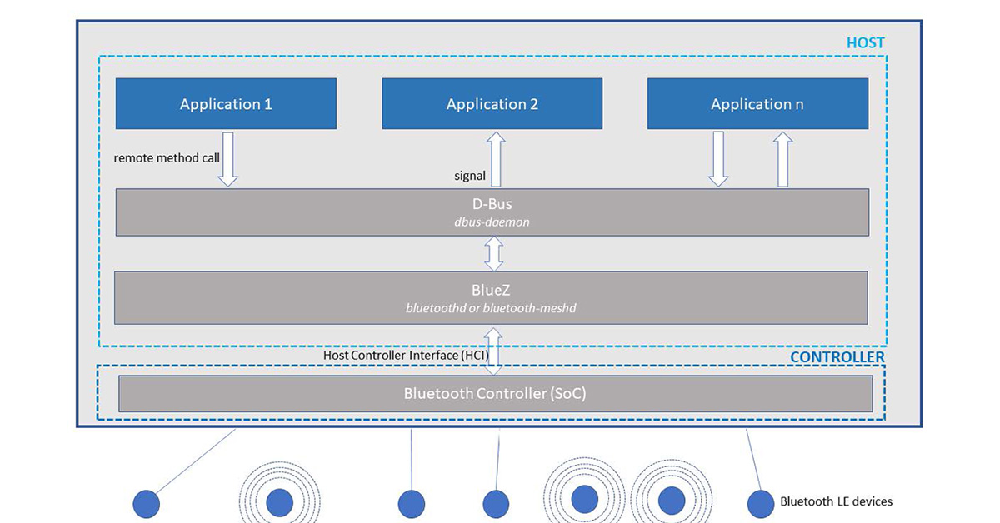

# Proposta: migração do projeto para inglês

Este documento mostra **como o projeto ficaria** se todo o código, a documentação e os nomes fossem para inglês. Nada aqui foi aplicado ainda.

A tradução é **literal**: o comportamento do código não muda. Há apenas duas correções pequenas, sinalizadas onde aparecem.

Critério de decisão: **quem vai ler o código?** Se for só a equipe do CNPEM, o domínio pode ficar em português. Se houver pessoas de fora (colaboração internacional, publicação aberta), use inglês no código com o glossário bilíngue.

---

## 1. Estrutura de pastas

```text
ANTES                                         DEPOIS
cnpem-projeto13-frente3/                      cnpem-projeto13-frente3/   (ver seção 4)
├── docs/                                     ├── docs/
│   ├── BLE_linux.md                          │   ├── ble-linux.md
│   ├── Linguagem-Ubiqua.md                   │   ├── ubiquitous-language.md
│   ├── Ponte BLE–TCP IP com handoff ...pdf   │   ├── ble-tcp-ip-bridge-handoff.pdf
│   ├── Projeto13.pdf                         │   ├── project-13.pdf
│   └── images/                               │   └── images/
│       └── linux-bluetooth-architecture.jpg  │       └── linux-bluetooth-architecture.jpg
└── src/                                      └── src/
    └── gateway/                                  └── collector/
        ├── __init__.py                               ├── __init__.py
        ├── main.py                                   ├── main.py
        ├── bluetooth/                                ├── bluetooth/
        │   ├── __init__.py                           │   ├── __init__.py
        │   └── scanner.py                            │   └── scanner.py
        └── mqtt/                                     └── mqtt/
            ├── __init__.py                               ├── __init__.py
            ├── client.py                                 ├── client.py
            └── command-init-broker.txt                   └── command-init-broker.txt
```

Ficam como estão: `README.md`, `LICENSE`, `Dockerfile`, `docker-compose.yml`, `requirements.txt`, `.gitignore`, `.dockerignore`, `start.sh`, `main.py`, `scanner.py` e `client.py`. Esses nomes já estão em inglês ou seguem convenção.

---

## 2. Mapa de renomeações

### Arquivos e pastas

| Antes | Depois |
|---|---|
| `src/gateway/` | `src/collector/` |
| `docs/Linguagem-Ubiqua.md` | `docs/ubiquitous-language.md` |
| `docs/BLE_linux.md` | `docs/ble-linux.md` |
| `docs/Ponte BLE–TCP IP com handoff entre dois PCs (Polar Verity Sense).pdf` | `docs/ble-tcp-ip-bridge-handoff.pdf` |
| `docs/Projeto13.pdf` | `docs/project-13.pdf` |
| serviço `gateway` (compose) | `collector` |
| container `cnpem_gateway_ble` | `cnpem_collector_ble` |

### Identificadores no código

| Antes | Depois |
|---|---|
| `PASTA_PAI` | `PARENT_DIR` |
| `teste_1_scan_simples` | `test_1_simple_scan` |
| `teste_2_busca_alternativa` | `test_2_alternative_search` |
| `teste_3_conexao_e_visibilidade` | `test_3_connection_and_visibility` |
| `tempo_permanencia` / `tempo_restante` | `hold_time` / `remaining_time` |
| `encontrado`, `match_nome`, `match_uuid` | `found`, `name_match`, `uuid_match` |
| `erro`, `opcao`, `nome` | `error`, `option`, `name` |
| `testar_invisibilidade_em_conexao` | `test_invisibility_while_connected` |

---

## 3. Conteúdo dos arquivos

### `docs/ubiquitous-language.md`

O glossário fica bilíngue: o código usa a coluna EN e a equipe pode continuar falando PT.

```markdown
# Ubiquitous Language
A shared, rigorous language used by everyone involved in the project. Its benefits include:
- Removes ambiguity: everyone uses exactly the same words to describe the system's concepts.
- Connects the business to the code: the vocabulary terms appear in the system.

## Terms

| Term (code) | Term (PT) | Definition |
| :--- | :--- | :--- |
| Researcher | Pesquisador | Person who wears the wristband. |
| Wristband | Pulseira | Polar wristband worn by the lab researchers to monitor vital signs. |
| BLE Collector | Coletor BLE | Raspberry Pi device used to connect to the wristband. Do not call it "gateway". |
```

### `src/collector/main.py`

```python
import asyncio
import os
import sys
from pathlib import Path

# Add the application directory to the Python search path
PARENT_DIR = Path(__file__).resolve().parent.parent
sys.path.append(str(PARENT_DIR))
sys.path.append(str(Path(__file__).resolve().parent))

# Import the functions from scanner.py
from bluetooth.scanner import *
from bleak import BleakScanner, BleakClient

# Target device settings for the tests (supports environment variables)
TARGET_ADDRESS = os.getenv("TARGET_ADDRESS", "F1142908-CB92-D7C9-C4E4-03C134ADB6A7")  # MAC (Linux) or UUID (macOS)
TARGET_NAME = os.getenv("TARGET_NAME", "Polar Verity")                                # Device name
TARGET_SERVICE_UUID = os.getenv("TARGET_SERVICE_UUID", "F1142908-CB92-D7C9-C4E4-03C134ADB6A7")  # Example: Heart Rate Service


async def test_1_simple_scan() -> None:
    """TEST 1: General scan of nearby devices.

    Used to confirm the device is present and to check whether its address
    stays the same across restarts.
    """
    print("\n" + "=" * 60)
    print("TEST 1: Simple Scan (Address/MAC Check)")
    print("=" * 60)
    print("Scanning for 5 seconds...\n")

    await find_all_local_devices()
     

async def test_2_alternative_search(
    target_name: str = TARGET_NAME, target_uuid: str = TARGET_SERVICE_UUID
) -> None:
    """TEST 2: Search by advertising data (name and services).

    Used when the device changes its MAC address periodically (RPA),
    allowing it to be filtered by alternative criteria.
    """
    print("\n" + "=" * 60)
    print("TEST 2: Search by Alternative Criteria (Name / Service)")
    print("=" * 60)
    print(f"Looking for Name: '{target_name}' or UUID: '{target_uuid}'...\n")

    # Returns the dictionary with detailed advertising packet data
    devices_dict = await BleakScanner.discover(return_adv=True, timeout=5.0)
    found = False

    for address, (device, adv_data) in devices_dict.items():
        name_match = (adv_data.local_name == target_name) or (device.name == target_name)
        uuid_match = bool(
            target_uuid
            and any(target_uuid.lower() == u.lower() for u in adv_data.service_uuids)
        )

        if name_match or uuid_match:
            found = True
            print(">>> Target Device Found! <<<")
            print(f"  - Current Address/UUID  : {address}")
            print(f"  - Advertised Local Name : {adv_data.local_name or device.name}")
            print(f"  - Signal (RSSI)         : {adv_data.rssi} dBm")
            print(f"  - Service UUIDs         : {adv_data.service_uuids}")
            print(f"  - Manufacturer Data     : {adv_data.manufacturer_data}")
            break

    if not found:
        print("Device not found by the specified alternative criteria.")


async def test_3_connection_and_visibility(
    address: str = TARGET_ADDRESS, hold_time: int = 20
) -> None:
    """TEST 3: GATT Connection and Concurrent Visibility Test.

    Connects to the device and keeps the session open so you can check
    whether the device becomes 'invisible' to a parallel scan (e.g. nRF Connect).
    """
    print("\n" + "=" * 60)
    print("TEST 3: Connection and Visibility Test (1:1)")
    print("=" * 60)
    print(f"Trying to connect to: {address}...\n")

    try:
        async with BleakClient(address, timeout=10.0) as client:
            if client.is_connected:
                print(" Connection established successfully!")
                print(
                    f"\n>>> Keep this window open and run a scan in the nRF Connect app now."
                )
                print(f">>> The connection will stay active for {hold_time} seconds...\n")

                for remaining_time in range(hold_time, 0, -5):
                    print(f"Connection active. Time remaining: {remaining_time}s...")
                    await asyncio.sleep(5)

                print("\nClosing connection session...")
    except Exception as error:
        print(f" Failed to connect to device {address}: {error}")


async def main() -> None:
    await connect_and_monitor_rssi("F1142908-CB92-D7C9-C4E4-03C134ADB6A7")
    # await find_all_local_devices()  
    # await connect_device("F1142908-CB92-D7C9-C4E4-03C134ADB6A7")

    # """Interactive menu for running the tests."""
    # while True:
    #     print("\n" + "#" * 50)
    #     print("      BLE TEST SUITE - WORKSTREAM 3 DIAGNOSTICS")
    #     print("#" * 50)
    #     print("1. Run Test 1: Simple Scan (Check MAC/UUIDs)")
    #     print("2. Run Test 2: Filter by Name/Service (Alternative Criteria)")
    #     print("3. Run Test 3: Test GATT Connection and Visibility on the phone")
    #     print("4. Run ALL tests in sequence")
    #     print("0. Exit")
    #
    #     option = input("\nSelect an option (0-4): ").strip()
    #
    #     if option == "1":
    #         await test_1_simple_scan()
    #     elif option == "2":
    #         await test_2_alternative_search()
    #     elif option == "3":
    #         await test_3_connection_and_visibility()
    #     elif option == "4":
    #         await test_1_simple_scan()
    #         await test_2_alternative_search()
    #         await test_3_connection_and_visibility()
    #     elif option == "0":
    #         print("\nExiting the test program.")
    #         break
    #     else:
    #         print("\nInvalid option. Enter a number from 0 to 4.")


if __name__ == "__main__":
    asyncio.run(main())
```

### `src/collector/bluetooth/scanner.py`

> Correção: no comentário do RSSI, o original tinha `--78`, que virou `-78`.

```python
import asyncio
from bleak import BleakClient
from bleak.exc import BleakError
import traceback
from bleak import BleakScanner

TARGET_ADDRESS="84B49860-9C1B-D2AC-9ABD-3074E2B20F9F"


"""RSSI must stay between -55 and -78, i.e. -78 < RSSI < -55"""
async def find_target_address(target_address=TARGET_ADDRESS):
    """Looks up a BLE Bluetooth device by address (MAC or UUID).

    Scans nearby devices. If it finds a device whose address matches
    `target_address`, returns the `BLEDevice` object.

    Args:
        target_address (str): MAC address (Linux/Windows) or UUID (macOS) of the target device.

    Returns:
        BLEDevice | None: The device object if found; otherwise, None.
    """
    devices = await BleakScanner.discover(
        # return_adv=True,
    )

    for device in devices:
        if device.address == target_address:
            print("FOUND")
            return device

    return None


async def find_all_local_devices():
    devices_dict = await BleakScanner.discover(return_adv=True, timeout=5.0)

    if not devices_dict:
        print("No BLE devices found in range.")
        return

    for address, (dev, adv_data) in devices_dict.items():
        name = dev.name or adv_data.local_name or "Unknown / Hidden"
        rssi = adv_data.rssi  
        print(f"Address: {address} | Name: {name:<25} | RSSI: {rssi} dBm")

    return devices_dict


async def find_by_alternative_criteria(target_name="Polar Verity", target_service_uuid=None):
    # Returns the device and the advertisement packet data
    devices_dict = await BleakScanner.discover(return_adv=True)
    
    for address, (device, adv_data) in devices_dict.items():
        # Filter by local name or advertised name
        if adv_data.local_name == target_name or device.name == target_name:
            print(f"Device found by Name! Current address: {address}")
            return device
            
        # Filter by service UUID (in case the name is hidden)
        if target_service_uuid and target_service_uuid in adv_data.service_uuids:
            print(f"Device found by GATT Service! Current address: {address}")
            return device

    print("Device not found by the alternative criteria.")
    return None


async def test_invisibility_while_connected():
    print(f"Connecting to {TARGET_ADDRESS}...")
    async with BleakClient(TARGET_ADDRESS) as client:
        if client.is_connected:
            print("Connection established successfully!")
            print(">>> Keep this window open and run a scan in nRF Connect on your phone now. <<<")
            # Keeps the connection active for 30 seconds to allow testing on the smartphone
            await asyncio.sleep(30)
    print("Connection closed.")


async def connect_device(target_address=TARGET_ADDRESS):
    print(f"Looking for device {target_address}...")
    device = await find_target_address(target_address)

    if device is None:
        print("Device not found in the initial scan. Check that it is powered on and advertising.")
        return

    print(f"Device found ({device.name or 'No Name'}). Trying to connect...")

    try:
        # Pass the 'device' object directly so Bleak doesn't run a new scan
        async with BleakClient(device, timeout=15.0) as client:
            print("Connected successfully!", client.is_connected)

            while client.is_connected:
                await get_current_rssi(client)

    except BleakError as e:
        # Show the exact Bleak exception class and its internal value
        print(f"Bleak connection failure [{type(e).__name__}]: {repr(e)}")

    except Exception as e:
        # Show the generic error type and print the full traceback to the terminal
        print(f"\n[ERROR Caught] Type: {type(e).__name__}")
        print(f"Error details: {repr(e)}")
        print("\n--- Full Failure Traceback (Stack Trace) ---")
        traceback.print_exc()

async def get_current_rssi(client, seconds_interval: float = 1.0):
    rssi = await client.get_rssi()
    print(f"Current RSSI: {rssi} dBm")

    await asyncio.sleep(seconds_interval)


async def connect_and_monitor_rssi(address: str = TARGET_ADDRESS):
    print(f"Looking for active device on macOS: {address}...")

    # Locate the device in real time without using cached objects
    device = await BleakScanner.find_device_by_address(address, timeout=10.0)

    if device is None:
        print("❌ Device not found in the scan. Make sure it is powered on and advertising.")
        return

    print(f"✅ Device found ({device.name or 'No Name'}). Trying to connect...")

    try:
        # Increase the timeout to 20.0s to give macOS CoreBluetooth enough time
        async with BleakClient(device, timeout=20.0) as client:
            print(f"🔗 Connected successfully! Status: {client.is_connected}")

            while client.is_connected:
                rssi = await client.get_rssi()
                print(f"📡 Current RSSI: {rssi} dBm")
                await asyncio.sleep(1.0)

    except asyncio.TimeoutError:
        print("\n❌ [TimeoutError] The macOS CoreBluetooth stack did not respond in time.")
        print("Recommended checks:")
        print(" 1. Disconnect the device from the phone's Bluetooth or other apps.")
        print(" 2. Remove the device from macOS 'System Settings > Bluetooth' (if paired).")
        print(" 3. Check the Terminal/IDE privacy permissions on macOS.")

    except BleakError as e:
        print(f"❌ Bleak library error: {e}")
    except Exception as e:
        print(f"❌ Unexpected error [{type(e).__name__}]: {e}")
        traceback.print_exc()
```

### `src/collector/bluetooth/__init__.py`

```python
"""Bluetooth scanner and utilities module."""
```

### `src/collector/mqtt/__init__.py`

```python
"""Machine-to-machine (M2M) MQTT communication module using HiveMQ."""
```

### Arquivos que só mudam de pasta

`src/collector/__init__.py`, `src/collector/mqtt/client.py` e `src/collector/mqtt/command-init-broker.txt` não têm texto em português; os comentários já estão em inglês.

> ⚠️ O `command-init-broker.txt` contém a license key do HiveMQ. Remova-a antes de commitar.

### `Dockerfile`

```dockerfile
FROM python:3.11-slim

# Prevents .pyc bytecode generation and ensures unbuffered real-time logs
ENV PYTHONDONTWRITEBYTECODE=1 \
    PYTHONUNBUFFERED=1 \
    PYTHONPATH=/app/src:/app/src/collector

# Packages required for Bluetooth communication (BlueZ and D-Bus) on Linux
RUN apt-get update && apt-get install -y --no-install-recommends \
    bluez \
    dbus \
    libglib2.0-0 \
    && rm -rf /var/lib/apt/lists/*

WORKDIR /app

# Install Python dependencies
COPY requirements.txt .
RUN pip install --no-cache-dir -r requirements.txt

# Copy the project source code
COPY src/ ./src/

# Default command to start the BLE collector
CMD ["python", "src/collector/main.py"]
```

### `docker-compose.yml`

```yaml
services:
  collector:
    build:
      context: .
      dockerfile: Dockerfile
    container_name: cnpem_collector_ble
    restart: unless-stopped

    # Direct access to the host network interface
    network_mode: "host"

    # Privileges required to control Bluetooth adapters and raw sockets
    privileged: true

    # Mounts the host operating system's D-Bus socket
    # Bleak (Linux) uses the host's bluetoothd daemon through D-Bus
    volumes:
      - /run/dbus/system_bus_socket:/run/dbus/system_bus_socket
      - ./src:/app/src

    # Enables interactive terminal mode (required for the input() menu in main.py)
    stdin_open: true
    tty: true

    environment:
      - PYTHONUNBUFFERED=1
```

### `start.sh`

```bash
#!/bin/bash

# Exit the script if any command fails
set -e

# --- Docker --- 

echo "Updating packages and installing initial dependencies..."
sudo apt-get update
sudo apt-get install -y ca-certificates curl gnupg

echo "Removing old packages that may cause conflicts..."
sudo apt remove $(dpkg --get-selections docker.io docker-compose docker-compose-v2 docker-doc docker-buildx podman-docker containerd runc | cut -f1)

echo "Adding Docker's official GPG key..."
sudo install -m 0755 -d /etc/apt/keyrings
curl -fsSL https://download.docker.com/linux/ubuntu/gpg | sudo gpg --dearmor -o /etc/apt/keyrings/docker.gpg
sudo chmod a+r /etc/apt/keyrings/docker.gpg

echo "Configuring the official Docker repository..."
echo \
  "deb [arch=$(dpkg --print-architecture) signed-by=/etc/apt/keyrings/docker.gpg] https://download.docker.com/linux/ubuntu \
  $(. /etc/os-release && echo "$VERSION_CODENAME") stable" | \
  sudo tee /etc/apt/sources.list.d/docker.list > /dev/null

echo "Updating the package list with the new repository..."
sudo apt-get update

echo "Installing Docker Engine and plugins (including Docker Compose)..."
sudo apt-get install -y docker-ce docker-ce-cli containerd.io docker-buildx-plugin docker-compose-plugin

echo "Starting and enabling the Docker service..."
sudo systemctl start docker

echo "Adding user $USER to the 'docker' group..."
sudo usermod -aG docker $USER

echo "Installation completed successfully!"
echo "WARNING: You must log out and log back in for the docker group permissions to take effect."
# --- End Docker --- 
```

### `docs/ble-linux.md`

```markdown
# How does the Bluetooth connection work on Linux?

## Hardware
The physical hardware, represented by a Raspberry Pi board. It contains the Bluetooth radio chip/adapter. The hardware's role is to transmit and receive electromagnetic waves (data packets) over the air.

## Operating System Layer (BlueZ)
BlueZ connects directly to the hardware. It is the official Linux kernel service responsible for managing the Bluetooth stack. It acts as a logical driver, translating the radio signals from the physical hardware
into structured protocols and vice versa.

## Messaging Layer (D-Bus)
D-Bus is a system service and a type of message-oriented middleware that provides IPC support for Linux applications.
To keep programs from accessing the Bluetooth hardware at the same time and causing conflicts, BlueZ exposes its functionality on D-Bus
through a specific socket located at `/var/run/dbus`.

## Application Layer (Code)
To interact with Bluetooth, my code connects to the same /var/run/dbus socket.
That is Bleak's role: it uses Python D-Bus clients to write and read information on this channel without terminals or commands.



### Reference
https://www.bluetooth.com/blog/the-bluetooth-for-linux-developers-study-guide/
```

### `README.md`

> Correção: os links para o `main.py` no README original eram `file:///Users/vimanzanovd/...` e só funcionam em um computador. Foram trocados por caminhos relativos (`src/collector/main.py`).

````markdown
# CNPEM - Project 13 Workstream 3
**Cardiac Monitoring and Stress Detection System for NB4**

BLE collector module for capturing and communicating via Bluetooth Low Energy (BLE) with the Polar Verity Sense sensor, built to integrate and transmit physiological data in the NB4 maximum biosafety laboratory environment (CNPEM).

---
## 📋 Table of Contents
- [Architecture and Technologies](#-architecture-and-technologies)
- [Folder Structure](#-folder-structure)
- [Key Difference: macOS vs. Linux](#️-key-difference-macos-vs-linux)
- [Running on macOS (Local Development)](#-running-on-macos-local-development)
- [Running on Linux (Docker & Docker Compose)](#-running-on-linux-docker--docker-compose)
- [Running on Native Linux (Without Docker)](#-running-on-native-linux-without-docker)
- [BLE Test Suite](#-ble-test-suite)
- [Environment Variables](#️-environment-variables)

---

## 🛠 Architecture and Technologies

- **Language:** Python 3.11+
- **BLE Communication:** [Bleak](https://bleak.readthedocs.io/) (uses CoreBluetooth on macOS and BlueZ/D-Bus on Linux)
- **Containerization:** Docker and Docker Compose
- **Target Device:** Polar Verity Sense (optical heart rate and PPG sensor)
- **Architecture:** https://dreampuf.github.io/GraphvizOnline/?engine=dot&compressed=... (same link as today)

---

## 📂 Folder Structure

```text
cnpem-projeto13-frente3/
├── .dockerignore
├── Dockerfile                  # Python image with BlueZ/D-Bus dependencies
├── docker-compose.yml          # Hardware privileges and volume configuration
├── requirements.txt            # Python dependencies (bleak)
├── README.md
├── docs/                       # Technical documentation and specifications
└── src/
    └── collector/
        ├── __init__.py
        ├── main.py             # Entry point and interactive test menu
        ├── bluetooth/
        │   ├── __init__.py
        │   └── scanner.py      # Scanning, filtering and GATT connection routines
        └── mqtt/
            ├── __init__.py
            └── client.py       # MQTT client (HiveMQ broker)
```

---

## ⚠️ Key Difference: macOS vs. Linux

The `bleak` library interacts with the Bluetooth hardware in different ways depending on the operating system:

| Feature | macOS | Linux (Container or Host) |
| :--- | :--- | :--- |
| **Bluetooth Stack** | Native Apple CoreBluetooth | BlueZ via D-Bus (`/run/dbus/system_bus_socket`) |
| **Sensor Identification** | UUID (e.g. `F1142908-CB92-...`) | MAC address (e.g. `C0:4E:01:XX:XX:XX`) |
| **Docker Support** | ❌ Not supported by Docker Desktop (VM without BLE passthrough) | Supported with `network_mode: host` and `privileged: true` |
| **Recommended Mode** | **Local virtual environment (`.venv`)** | **Docker Compose or Native** |

---

## 🍏 Running on macOS (Local Development)

On macOS, **do not use Docker** for BLE testing: Docker Desktop runs inside a virtual machine that has no access to the Mac's Bluetooth chip. Run the project directly in the terminal:

### 1. Create and Activate the Virtual Environment

```bash
# From the project root:
python3 -m venv .venv
source .venv/bin/activate
```

### 2. Install the Dependencies

```bash
pip install --upgrade pip
pip install -r requirements.txt
```

### 3. Run the Collector

```bash
python src/collector/main.py
```

> **Note:** On the first run, macOS will show a dialog asking permission for your Terminal or IDE to access **Bluetooth**. Click **"Allow"** (or configure it in *System Settings > Privacy & Security > Bluetooth*).

---

## 🐧 Running on Linux (Docker & Docker Compose)

This is the intended mode for the lab's computers and collectors (Ubuntu, Debian or Raspberry Pi OS).

### 1. Host System Prerequisites

Make sure the D-Bus and BlueZ daemons are running on the host:

```bash
sudo systemctl enable --now dbus
sudo systemctl enable --now bluetooth

# Check that the Bluetooth adapter is active (UP)
hciconfig hci0
# If it is DOWN:
# sudo hciconfig hci0 up

# Check whether the user is in the bluetooth group
# groups
# If not:
# sudo usermod -aG bluetooth $USER
# Check that the permission is correct. It must be readable and writable by all users, or by the associated group
# ls -l /var/run/dbus/system_bus_socket
```

### 2. Configure the Device Address

On Linux, Bluetooth uses the physical MAC address. You can pass the MAC through an environment variable or uncomment it in `docker-compose.yml`:

```bash
export TARGET_ADDRESS="C0:4E:01:XX:XX:XX"
```

### 3. Run with Docker Compose

Since [`main.py`](src/collector/main.py) has an interactive menu (`input`), run it with the terminal attached:

```bash
# Interactive run with attached terminal:
docker compose run --rm collector

# Or build and start the image in the background:
docker compose up -d --build
```

---

## 🐧 Running on Native Linux (Without Docker)

If you prefer to run without containers on Linux:

```bash
# 1. Install the BlueZ system libraries
sudo apt-get update && sudo apt-get install -y bluez libbluetooth-dev dbus

# 2. Create a virtual environment and install packages
python3 -m venv .venv
source .venv/bin/activate
pip install -r requirements.txt

# 3. Run
python src/collector/main.py
```

---

## 🧪 BLE Test Suite

When you start [`main.py`](src/collector/main.py), the following interactive menu is shown:

```text
##################################################
      BLE TEST SUITE - WORKSTREAM 3 DIAGNOSTICS
##################################################
1. Run Test 1: Simple Scan (Check MAC/UUIDs)
2. Run Test 2: Filter by Name/Service (Alternative Criteria)
3. Run Test 3: Test GATT Connection and Visibility on the phone
4. Run ALL tests in sequence
0. Exit
```

### Test Descriptions:
* **Test 1 (Simple Scan):** Runs a general 5-second scan listing every BLE device in range, with its address (MAC/UUID), advertised name and signal strength (RSSI in dBm).
* **Test 2 (Alternative Criteria):** Finds the device by filtering on the advertising packet name (`TARGET_NAME`, e.g. `"Polar Verity"`) or service UUID (`TARGET_SERVICE_UUID`). Essential when the sensor uses a random/rotating MAC address (RPA).
* **Test 3 (Connection and Concurrent Visibility):** Opens a 20-second GATT connection to the sensor. Lets you check in the *nRF Connect* smartphone app whether the sensor becomes invisible to new scans while connected (1:1 relationship and handoff support).
* **Test 4 (All):** Runs the three diagnostic tests in sequence.

---

## ⚙️ Environment Variables

The application accepts customization through environment variables, so parameters can be changed without touching the code:

| Variable | Default | Description |
| :--- | :--- | :--- |
| `TARGET_ADDRESS` | `F1142908-CB92-...` | MAC address (Linux) or UUID (macOS) of the target sensor |
| `TARGET_NAME` | `Polar Verity` | Local name advertised by the device in BLE advertising |
| `TARGET_SERVICE_UUID`| `F1142908-CB92-...` | GATT service UUID advertised, used for filter validation |
| `PYTHONUNBUFFERED` | `1` | Ensures logs are sent immediately to the terminal/container |

Command-line usage example:
```bash
TARGET_ADDRESS="C0:4E:01:23:45:67" TARGET_NAME="Polar Verity Sense" python src/collector/main.py
```

---
````

---

## 4. Fora dos arquivos

| Item | Mudança |
|---|---|
| **Tópicos MQTT** | `cnpem/collector/{collector_id}/status` e `cnpem/collector/{collector_id}/wristband/{wristband_id}/rssi` / `.../status`. Estados: `connected`, `disconnected`, `weak-connection`, `not-found`. |
| **Branches** | `comunicacao-m2m` → `m2m-communication`; as novas branches já nascem em inglês (ex.: `bluetooth-connection`). |
| **Commits** | As mensagens daqui para frente ficam em inglês (`feat: test device connection and RSSI`). O histórico antigo continua como está. |
| **Nome do repositório** (opcional) | `cnpem-projeto13-frente3` → `cnpem-project13-workstream3`. Muda a URL do remote; o GitHub redireciona a antiga. |
| **PDFs** | Só mudam de nome. O conteúdo continua em português, a não ser que alguém traduza à mão. |
| **Diagrama Graphviz** do README | Se os rótulos dentro do diagrama estiverem em português, precisam ser editados no próprio GraphvizOnline, o que gera um link novo. |
| **Não mudam** | `.gitignore`, `.dockerignore`, `requirements.txt`, `LICENSE` e as variáveis de ambiente (`TARGET_*` já estão em inglês). |

---

## 5. Como aplicar

Use `git mv` nas renomeações, para que o Git mantenha o histórico de cada arquivo:

```bash
git mv src/gateway src/collector
git mv docs/Linguagem-Ubiqua.md docs/ubiquitous-language.md
git mv docs/BLE_linux.md docs/ble-linux.md
git mv "docs/Ponte BLE–TCP IP com handoff entre dois PCs (Polar Verity Sense).pdf" docs/ble-tcp-ip-bridge-handoff.pdf
git mv docs/Projeto13.pdf docs/project-13.pdf
```

Depois, atualize o conteúdo dos arquivos conforme a seção 3. Faça as renomeações num commit e as traduções em outro: assim o Git reconhece as renomeações e o diff das traduções fica legível.

> `src/gateway/mqtt/` ainda não foi commitado. O `git mv src/gateway src/collector` move a pasta inteira, inclusive esses arquivos não rastreados, mas eles continuam não rastreados até um `git add`.
